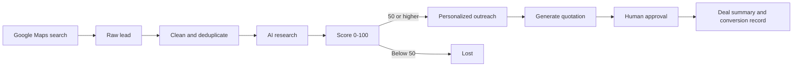
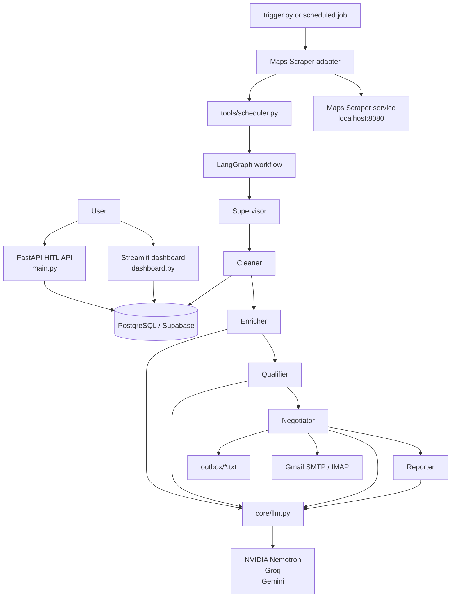
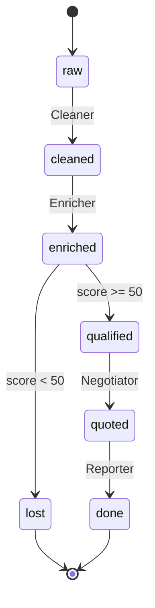
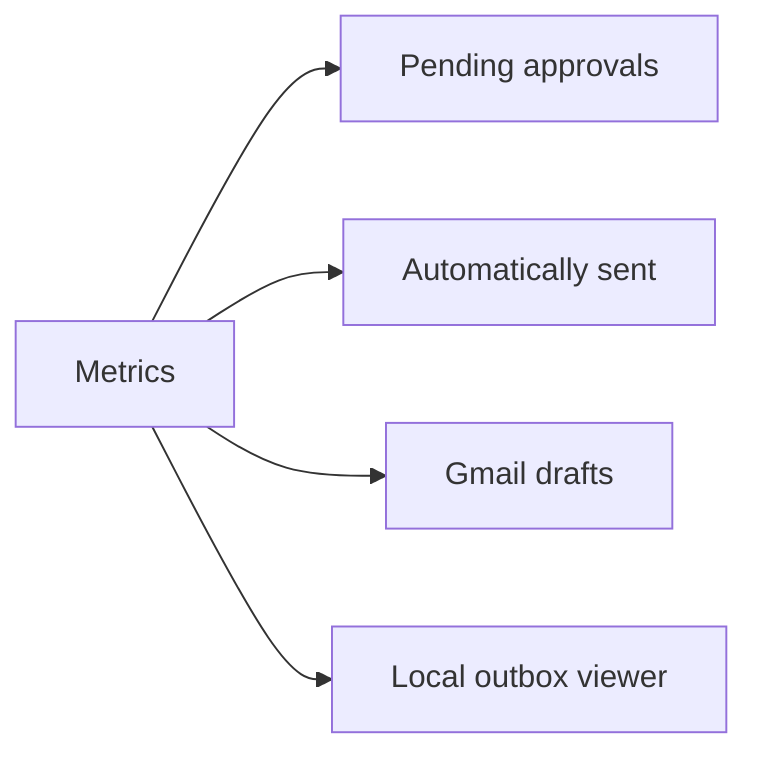

# Baton

**Baton is an autonomous AI sales pipeline for discovering, researching, scoring, and
contacting local-business leads.** It combines a Google Maps scraper, a PostgreSQL/Supabase
database, multiple LLM providers, Gmail delivery, and a human approval API.

The project is designed to move a lead through a repeatable workflow:



## What users can do

- Search for a business type in a location and collect lead data.
- Normalize fields such as name, email, phone, website, and category.
- Ask an AI model to identify digital-marketing gaps and pain points.
- Score each lead using traction, gap, and business-fit signals.
- Send a personalized email when an address is available.
- Save a Gmail draft and a local backup when no address is found.
- Generate a proposal and place it in a human approval queue.
- Review lead metrics, links, approval requests, and local email drafts in the dashboard.

## System overview



### Main components

| Area | Files | Responsibility |
| --- | --- | --- |
| Application startup | [`main.py`](main.py) | Initializes the database pool, starts APScheduler, and serves the FastAPI app on port 8000. |
| Manual pipeline trigger | [`trigger.py`](trigger.py) | Runs one scrape-and-process pipeline using its configured query and location. |
| User dashboard | [`dashboard.py`](dashboard.py) | Displays scored leads, sent leads, Gmail-draft leads, pending approvals, and local email backups. |
| Workflow | [`agents/graph.py`](agents/graph.py), [`agents/supervisor.py`](agents/supervisor.py) | Builds and routes the LangGraph state machine. |
| Agents | [`agents/`](agents/) | Cleans, enriches, qualifies, negotiates, and reports on leads. |
| Integrations | [`adapters/scraper.py`](adapters/scraper.py), [`adapters/email.py`](adapters/email.py) | Connects to the Maps Scraper and Gmail. |
| Scheduling | [`tools/scheduler.py`](tools/scheduler.py) | Runs scrape jobs and submits leads to the workflow. |
| Approval API | [`tools/hitl_dashboard.py`](tools/hitl_dashboard.py) | Lists, approves, and rejects pending quotations. |
| Database | [`db/schema.sql`](db/schema.sql), [`core/db.py`](core/db.py) | Defines the PostgreSQL schema and manages async connections. |
| LLM routing | [`core/llm.py`](core/llm.py) | Selects an LLM provider, enforces request limits, and records token usage. |

## Lead lifecycle

Every lead is represented by a `BatonState` object and moves through stages:



1. **Raw** - the scraper result is stored in `leads.raw_data`.
2. **Cleaned** - aliases are normalized, email/phone values are cleaned, and a SHA-256
   deduplication key is calculated.
3. **Enriched** - the Nemotron model returns a research object containing a technology
   stack, pain points, and a summary.
4. **Qualified** - Groq returns a structured score from 0 to 100. Scores below 50 are
   marked `lost`.
5. **Quoted** - qualified leads receive outreach, a proposal is generated, and an approval
   record is created.
6. **Done** - a final summary is generated and a conversion event is written.

## Prerequisites

- Python 3.11 or newer is recommended.
- A PostgreSQL database compatible with the schema. Supabase is the intended deployment.
- PostgreSQL extensions available for `vector`, `pg_trgm`, and `uuid-ossp`.
- API keys for NVIDIA, Groq, and Gemini.
- A running Maps Scraper service at `http://localhost:8080`.
- A Gmail account with an app password if sending mail or saving drafts.
- Node.js 18+ only if you plan to run the bundled Gmail MCP service. The current email
  adapter sends through Gmail SMTP and saves drafts through Gmail IMAP.

## Installation

From PowerShell:

```powershell
py -3.11 -m venv .venv
.\.venv\Scripts\Activate.ps1
python -m pip install --upgrade pip
pip install -r requirements.txt
```

The Streamlit dashboard has additional packages that are not currently listed in
`requirements.txt`:

```powershell
pip install streamlit pandas sqlalchemy
```

## Configuration

Copy the example file and fill in real values:

```powershell
Copy-Item .env.example .env
```

Required values are:

| Variable | Purpose |
| --- | --- |
| `SUPABASE_URL` | Supabase project URL. |
| `SUPABASE_SERVICE_KEY` | Server-side Supabase service key. Keep it secret. |
| `DB_DSN` | PostgreSQL connection string used by psycopg and LangGraph checkpoints. |
| `NVIDIA_API_KEY` | Nemotron enrichment, outreach, proposal, and summary calls. |
| `GROQ_API_KEY` | Fast lead qualification calls. |
| `GEMINI_API_KEY` | Summary/embedding support and Gemini provider calls. |
| `GMAIL_USER` | Gmail address used by SMTP/IMAP. |
| `GMAIL_APP_PASSWORD` | Gmail app password, not the normal account password. |

Optional values control provider request limits and local service URLs:
`NVIDIA_RPM`, `GROQ_RPM`, `GEMINI_RPM`, `MAPS_SCRAPER_URL`, `GMAIL_MCP_URL`, and
`HITL_APPROVAL_TIMEOUT_SECONDS`.

Apply the database schema before starting the application:

```powershell
psql "$env:DB_DSN" -f db/schema.sql
```

If your DSN contains characters that PowerShell expands unexpectedly, use the same
PostgreSQL command from a shell that supports your provider's connection-string format.

## Start the supporting services

### Maps Scraper

The scraper adapter expects the Maps Scraper REST API on port 8080:

```powershell
Set-Location vendor\maps-scraper
docker compose up -d
Set-Location ..\..
```

### Gmail MCP (optional)

The repository includes a Gmail MCP service under `vendor/gmail-mcp`:

```powershell
Set-Location vendor\gmail-mcp
npm install
npm run build
npm start
Set-Location ..\..
```

The service is configured for `http://localhost:3100`. It is optional for the currently
implemented SMTP/IMAP email adapter, but is retained as a project integration option.

## Run Baton

### Run one pipeline manually

Edit the query and location in [`trigger.py`](trigger.py), then run:

```powershell
python trigger.py
```

The current trigger starts the pipeline for `plumbers` in `Los Angeles, CA`.

### Run the application and approval API

```powershell
python main.py
```

The FastAPI service is available at:

- Health check: `http://localhost:8000/health`
- Pending approvals: `http://localhost:8000/approvals`
- Interactive API documentation: `http://localhost:8000/docs`

Approval actions require a query parameter:

```text
POST /approvals/{approval_id}/approve?approved_by=your-name
POST /approvals/{approval_id}/reject?approved_by=your-name&notes=reason
```

### Open the graphical dashboard

Run this in a second PowerShell window:

```powershell
streamlit run dashboard.py
```

Then open the URL Streamlit prints, normally `http://localhost:8501`.

The dashboard shows:



- **Metrics** counts sent leads, draft-only leads, pending approvals, and scored leads.
- **Pending Human Approvals** lists quotation amount, lead, and line items.
- **Sent Automatically** shows leads with an email address and clickable web/social links.
- **Saved to Gmail Drafts** shows leads without an email address.
- **Read Local Email Drafts** opens the backup files written to `outbox/`.

The dashboard refreshes its database data every 10 seconds. It reads the same PostgreSQL
database as the API and pipeline.

## LLM routing

All agent model calls go through [`core/llm.py`](core/llm.py):

| Provider name | Current model configured in code | Main use |
| --- | --- | --- |
| `nemotron` | `nvidia/nemotron-3-ultra-550b-a55b` | Research, outreach, proposals, and detailed summaries. |
| `groq` | `qwen/qwen3.8-27b` | Fast structured qualification scoring. |
| `gemini` | `gemini-3.8-flash` | General Gemini calls and summary support. |

Requests are rate-limited in memory and usage is recorded in the `rate_limit_log` table.
The `embed()` helper uses Gemini `text-embedding-004` and expects a 1536-dimensional
vector.

## Database at a glance

The schema in [`db/schema.sql`](db/schema.sql) stores:

- Lead identity, source data, normalized metadata, stage, and score.
- AI enrichment payloads and workflow stage transitions.
- Conversations, messages, and outreach events.
- Quotations and human approval decisions.
- Conversion values and timestamps.
- LLM rate-limit usage and semantic-memory embeddings.

The LangGraph checkpointer also uses PostgreSQL when `run_graph()` receives a DSN, allowing
workflow state to be associated with a lead thread.

## Tests

Run the test suite with:

```powershell
pytest
```

The tests mirror the source tree and cover configuration, database helpers, LLM routing,
adapters, agents, scheduling, and the approval API. Tests that exercise external services
should be run with the required environment variables and service mocks/configuration.

## Important implementation notes

- `main.py` starts the scheduler, but it does not automatically register a scrape job.
  Use `trigger.py` for the included one-off run or call `add_scrape_job()` from your own
  integration.
- `adapters/scraper.py` submits a job, polls it, and downloads CSV output from the Maps
  Scraper API. The current request payload contains fixed Austin coordinates, so verify
  the scraper service behavior before relying on arbitrary locations.
- A qualified lead is sent outreach and immediately receives a quotation approval record.
  Approval is exposed through the API/dashboard; the current graph does not wait for the
  approval result before generating the reporter summary.
- Email with a discovered address is sent over Gmail SMTP. Without an address, the message
  is saved to Gmail Drafts through IMAP and also written to `outbox/email_<lead-id>.txt`.
- The repository's `vendor/` directory is ignored by Git. Supporting services must be
  installed or available locally when needed.
- Never commit `.env`, API keys, Gmail app passwords, database credentials, or generated
  outbox files.

## Project layout

```text
Baton/
├── adapters/             # Maps Scraper and Gmail integrations
├── agents/               # LangGraph workflow nodes
├── core/                 # Settings, database pool, and LLM routing
├── db/schema.sql         # PostgreSQL/Supabase schema
├── docs/                 # Design and implementation notes
├── outbox/               # Local email backups (ignored by Git)
├── tests/                # Unit tests
├── tools/                # Scheduler and FastAPI approval API
├── dashboard.py          # Streamlit graphical dashboard
├── main.py               # FastAPI application entry point
├── trigger.py            # One-off scrape pipeline entry point
├── requirements.txt      # Python dependencies
└── .env.example          # Configuration template
```

## Troubleshooting

| Symptom | Check |
| --- | --- |
| Settings validation fails on startup | Confirm every required variable in `.env` is present and named exactly as in [Configuration](#configuration). |
| Database connection errors | Check `DB_DSN`, schema installation, PostgreSQL extensions, and network access to Supabase. |
| No scraper results | Confirm Docker is running and `http://localhost:8080` is reachable. |
| Gmail authentication fails | Use a Gmail app password and verify `GMAIL_USER` and `GMAIL_APP_PASSWORD`. |
| Dashboard cannot connect | Start PostgreSQL configuration first; the dashboard reads `DB_DSN` directly. |
| No approval rows appear | Confirm a qualified lead reached the negotiation stage and inserted a quotation/approval record. |
| LLM calls fail | Check the relevant provider key, provider rate limit, and the model name configured in `core/llm.py`. |

